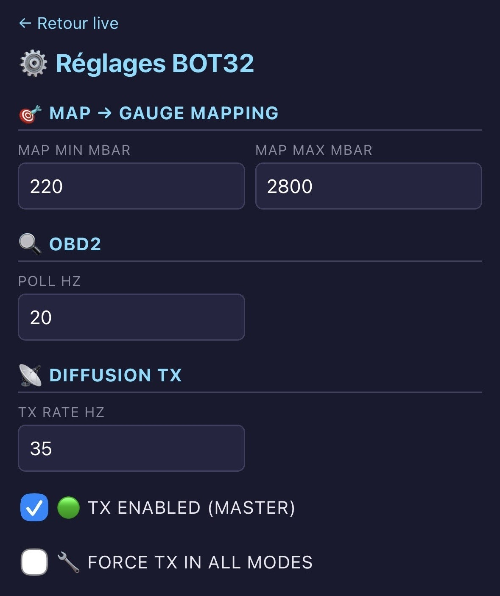
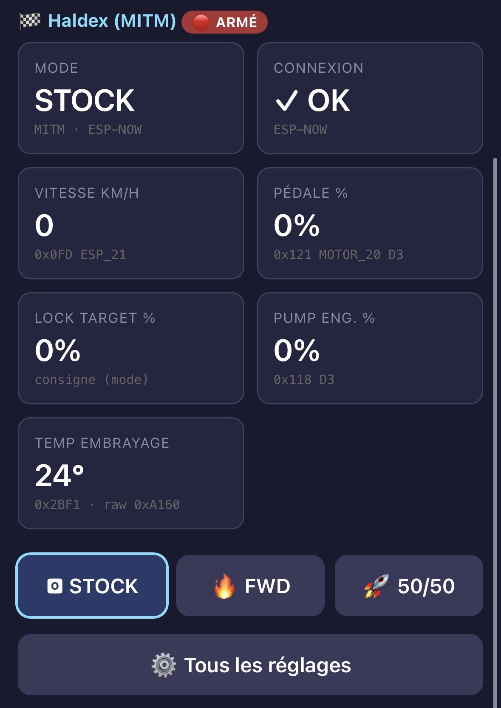
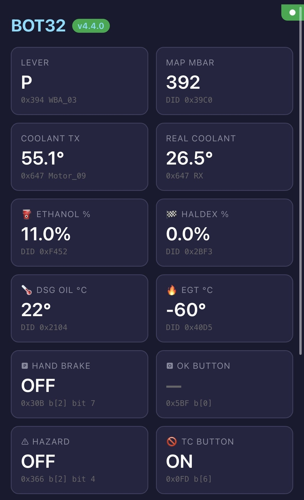
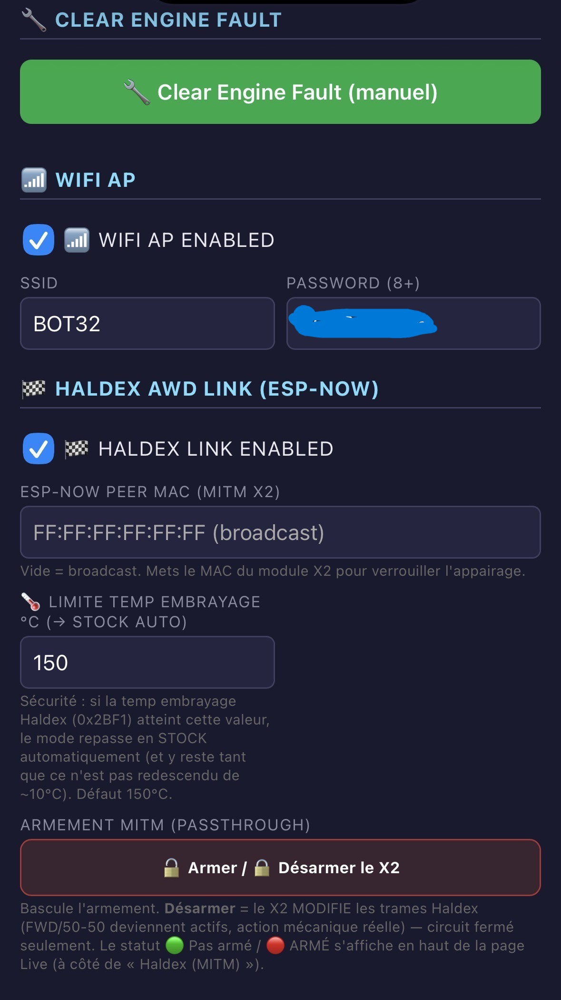

# BOT32 — Mobile UI screenshots

Captures de l'interface web mobile (servie par l'ESP32 Main sur son AP WiFi).

> ℹ️ Ces captures datent de **v4.4.0** et sont **antérieures à la version actuelle
> (v4.6.0)**. Différences connues :
> - **v4.5.0** : la temp embrayage est en **affichage seul** — le champ « Limite temp
>   embrayage » et le « raw 0x2BF1 » visibles ici ont été **retirés** (la protection
>   thermique native du Haldex suffit).
> - **v4.6.0** : nouveau bloc **« Effacer les codes moteur »** avec texte d'aide (moteur
>   seulement, écoute seule), **aide-mémoire** des combinaisons de boutons, bouton
>   « Armer / Désarmer le X2 » de la page Réglages réparé.
>
> Pour le reste, l'UI correspond aux captures.

| Capture | Description |
|---|---|
|  | **Réglages (haut)** — MAP → Gauge mapping, OBD2 (Poll Hz), Diffusion TX |
|  | **Live — Haldex (MITM)** — badge armé 🟢/🔴, mode, vitesse/pédale, lock target, pump %, **temp embrayage + raw 0x2BF1**, boutons STOCK/FWD/50-50 |
|  | **Live — grille principale** — lever, MAP, coolant TX/réel, éthanol, Haldex %, DSG/EGT, sniffers (frein à main, OK, hazard, TC) |
|  | **Réglages (bas)** — bouton Clear Engine Fault, WiFi AP (mot de passe masqué), Haldex link (MAC, **limite temp embrayage**, Armer/Désarmer) |
